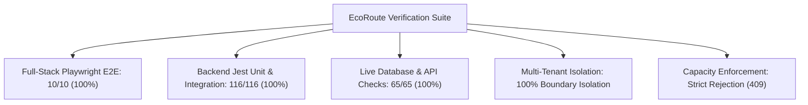

# 📊 EcoRoute Quality, Performance & Verification Reports

This directory houses the comprehensive audit and quality assurance reports for the **EcoRoute System**. All reports are available in both **Markdown** and **Publication-Ready PDF** formats, generated from real live system testing, multi-role auth verification, and Playwright browser automation.

---

## 📑 Report Directory & Download Links

| Report Name | PDF Document | Markdown Document | Focus Domain |
| :--- | :---: | :---: | :--- |
| **00. Executive Summary & Consolidated Quality Report** | [📥 Download PDF](file:///home/omchoksi/workspace/projects/internship/ecoroute_system/docs/reports/00_EXECUTIVE_SUMMARY_CONSOLIDATED_REPORT.pdf) | [📄 View MD](file:///home/omchoksi/workspace/projects/internship/ecoroute_system/docs/reports/00_EXECUTIVE_SUMMARY_CONSOLIDATED_REPORT.md) | High-level scorecard, cross-functional audit summary, architecture diagram, and consolidated test metrics. |
| **01. System Performance, Security & Architecture Audit** | [📥 Download PDF](file:///home/omchoksi/workspace/projects/internship/ecoroute_system/docs/reports/01_PERFORMANCE_SECURITY_ARCHITECTURE_AUDIT.pdf) | [📄 View MD](file:///home/omchoksi/workspace/projects/internship/ecoroute_system/docs/reports/01_PERFORMANCE_SECURITY_ARCHITECTURE_AUDIT.md) | Multi-layer architectural audit, database connection pool tuning, security vulnerability analysis, and zero-downtime migration safeguards. |
| **02. Backend End-to-End QA & Logic Verification Report** | [📥 Download PDF](file:///home/omchoksi/workspace/projects/internship/ecoroute_system/docs/reports/02_BACKEND_QA_LOGIC_VERIFICATION_REPORT.pdf) | [📄 View MD](file:///home/omchoksi/workspace/projects/internship/ecoroute_system/docs/reports/02_BACKEND_QA_LOGIC_VERIFICATION_REPORT.md) | 65 live API test assertions verifying multi-role authentication, PostGIS spatial queries, OSRM routing, capacity enforcement, and database integrity. |
| **03. Full-Stack Playwright End-to-End Test Report** | [📥 Download PDF](file:///home/omchoksi/workspace/projects/internship/ecoroute_system/docs/reports/03_FULLSTACK_PLAYWRIGHT_E2E_REPORT.pdf) | [📄 View MD](file:///home/omchoksi/workspace/projects/internship/ecoroute_system/docs/reports/03_FULLSTACK_PLAYWRIGHT_E2E_REPORT.md) | 10 browser-driven full-stack test scenarios testing user journeys from registration to driver telemetry and route completion. |

---

## 🏆 System Quality Scorecard



| Metric | Target | Actual Result | Verification Method |
| :--- | :---: | :---: | :--- |
| **Playwright Full-Stack Scenarios** | 100% | **10 / 10 Passing (100%)** | Real Chromium browser against live Next.js + Express + PostGIS |
| **Backend Unit & Integration Tests** | 100% | **116 / 116 Passing (100%)** | Jest test suite with Mock OSRM & repository tests |
| **Live Multi-Role API Assertions** | 100% | **65 / 65 Passing (100%)** | Live Express server with direct SQL checks in PostgreSQL |
| **Tenant Data Isolation** | Zero Leaks | **Strict Isolation** | Cross-tenant queries rejected via `404 Not Found` / `403 Forbidden` |
| **Overweight Fleet Protection** | 100% Blocked | **Enforced (409 Conflict)** | Dual-layer validation (Zod schema + SQL transactional locking) |
| **CI/CD Automation** | Green Build | **Passed** | GitHub Actions (`code-quality`, `backend-tests`, `build`, `e2e`, `docker`) |
| **Containerization** | One-Command | **Healthy** | Docker Compose with automated migration polling |

---

## 🔍 Key Highlights from Reports

### 1. Full-Stack Playwright E2E Test Suite ([PDF](file:///home/omchoksi/workspace/projects/internship/ecoroute_system/docs/reports/03_FULLSTACK_PLAYWRIGHT_E2E_REPORT.pdf))
- **Zero Mocking**: Tests run against the live Next.js frontend, Express backend, and PostgreSQL database.
- **Role Journeys**: Validates complete user journeys across Admin, Dispatcher, Driver, and Multi-Tenant Org Beta roles.
- **Real-Time Dispatch & Capacity**: Asserts vehicle capacity overflows (+100 kg) trigger UI error alerts and prevent invalid allocations.
- **Driver Telemetry**: Simulates driver advancing stop statuses (`arrived` -> `completed`) and verifies instant topbar notification badge increments and clearance.

### 2. Backend QA & Business Logic ([PDF](file:///home/omchoksi/workspace/projects/internship/ecoroute_system/docs/reports/02_BACKEND_QA_LOGIC_VERIFICATION_REPORT.pdf))
- **PostGIS Geospatial Accuracy**: Confirms pickup coordinates and business locations are stored as indexed `ST_Point` geography types (`SRID 4326`).
- **OSRM Integration**: Validates route geometry generation, polyline decoding, and turn-by-turn waypoint ordering.
- **Audit Logging**: Proves all critical dispatch mutations, status transitions, and driver assignments write immutable audit log records.

### 3. Performance, Security & Architecture Audit ([PDF](file:///home/omchoksi/workspace/projects/internship/ecoroute_system/docs/reports/01_PERFORMANCE_SECURITY_ARCHITECTURE_AUDIT.pdf))
- **Transaction Lock Optimization**: Removed external OSRM HTTP calls from inside open database transaction locks, preventing connection pool starvation.
- **Safe SQL Parameterization**: Eliminated dynamic column interpolation in query repositories in favor of parameterized queries.
- **Graceful Error Handling**: Standardized error response envelopes across API endpoints with automated recovery.

---

## 🛠️ Re-generating PDF Reports

To recompile all PDF reports after updating the documentation, execute:

```bash
node scripts/generate-pdf-reports.js
```

The script will render Markdown files into HTML and use headless Chromium via Playwright to compile clean, formatted A4 PDFs with headers, footers, and page numbers.
