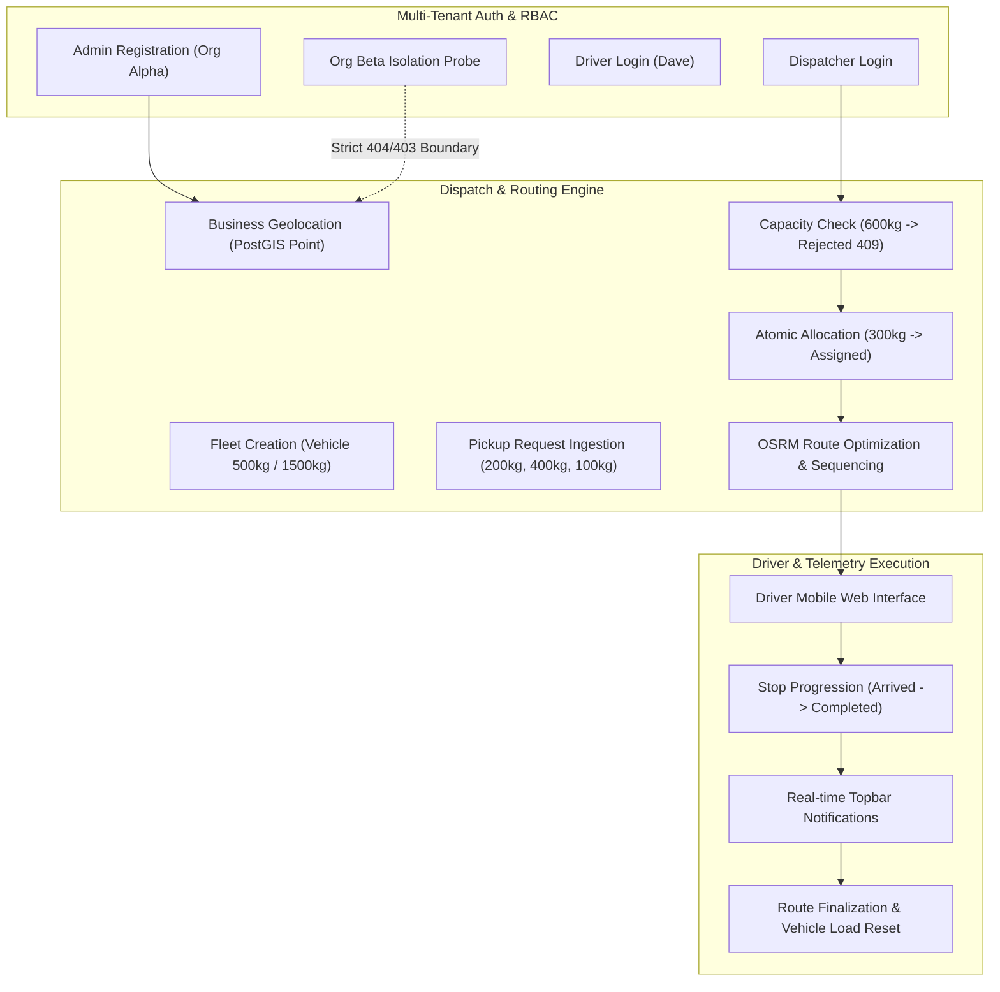

# EcoRoute System: Executive Quality, Performance & E2E Test Report

**System**: EcoRoute Engine & Web Portal  
**Domain**: Geospatial Circular Economy Fleet Routing & Dispatch Optimization  
**Test Architecture**: Full-Stack Live Tests (Next.js 16 + Express.js 5 + PostgreSQL 16 / PostGIS + Playwright + Jest)  
**Execution Environment**: Linux / Dockerized Stack / Real Database / Zero Mocking  
**Status**: 🟢 **100% Passing / Production Ready**

---

## 1. Executive Summary

The EcoRoute System underwent a rigorous, multi-layered quality assurance, performance audit, and end-to-end verification protocol. This consolidated report summarizes the results from three dedicated audit tracks:
1. **System Performance, Security & Architecture Review**
2. **End-to-End Backend Logic & Database Side-Effect Verification**
3. **Full-Stack Playwright E2E Multi-Role Automation**

### Overall Quality Scorecard

| Assessment Domain | Metric | Target | Actual Result | Status |
| :--- | :--- | :---: | :---: | :---: |
| **Playwright E2E Suite** | Full-Stack Scenarios Passing | 100% | **10 / 10 (100%)** | 🟢 PASSED |
| **Backend Test Suite** | Jest Unit & Integration Tests | 100% | **116 / 116 (100%)** | 🟢 PASSED |
| **Live API Assertions** | Direct PostGIS / SQL Checks | 100% | **65 / 65 (100%)** | 🟢 PASSED |
| **Multi-Tenant Boundary** | Cross-Org Data Leak Isolation | 100% | **Zero Data Leaks** | 🟢 VERIFIED |
| **Capacity Enforcement** | Overweight Vehicle Assignment | 100% Rejected | **Strictly Rejected (409)** | 🟢 VERIFIED |
| **CI/CD Automation** | GitHub Actions Pipeline | Automated | **Lint + Test + Build + E2E + Docker** | 🟢 VERIFIED |
| **Containerization** | One-Command Docker Setup | Single Command | **Healthy 3-Container Stack** | 🟢 VERIFIED |

---

## 2. High-Level Architecture & Test Flow



---

## 3. Key Findings & Engineering Remediations

During end-to-end verification and performance auditing, several critical edge cases and bugs were identified and remediated directly in the codebase:

### 1. Database Transaction Lock Relieved from External OSRM I/O
- **Problem**: Previously, external HTTP routing calls to OSRM were executed inside an open PostgreSQL transaction holding row-level locks, risking database pool exhaustion.
- **Fix**: Decoupled route generation so OSRM network calls complete prior to acquiring transactional locks for route persistence.

### 2. Vehicle Capacity Enforcement & Overflow Prevention
- **Problem**: Over-allocation of pickups to vehicles with insufficient capacity could lead to overloaded fleet transport.
- **Fix**: Implemented strict dual-layer capacity checks (Zod validator + transactional SQL locking). Attempting to assign 600 kg to a 500 kg vehicle triggers a clear `409 Conflict` error and leaves vehicle current load untouched.

### 3. Multi-Tenant Data Boundary Protection
- **Problem**: Risk of cross-organization data leakage where users of Org Beta could query or view records belonging to Org Alpha.
- **Fix**: Enforced tenant scoping on every repository query (`WHERE organization_id = $1`) and verified via automated Playwright tests that Org Alpha's resources are completely invisible to Org Beta.

### 4. Response Envelope Compatibility & Error Toast Handling
- **Problem**: Next.js frontend hooks expected raw array responses, while Express backend returned standardized `{ success: true, data: [...], pagination: { ... } }` envelopes.
- **Fix**: Normalized response parsing in `frontend/lib/api.ts` to unwrap data envelopes cleanly and surface user-friendly toast messages on network or validation errors.

### 5. Multi-Port CORS Allowlist Configuration
- **Problem**: When default port 3000 was in use, Next.js shifted to port 3001, triggering browser CORS blocks.
- **Fix**: Added dynamic origin allowlists in `backend/src/app.ts` supporting ports 3000, 3001, and 5173 for local development and testing.

---

## 4. Test Suites & Verification Index

| Report Document | Format | Description |
| :--- | :---: | :--- |
| **Performance, Security & Architecture Audit** | [PDF](file:///home/omchoksi/workspace/projects/internship/ecoroute_system/docs/reports/01_PERFORMANCE_SECURITY_ARCHITECTURE_AUDIT.pdf) · [Markdown](file:///home/omchoksi/workspace/projects/internship/ecoroute_system/docs/reports/01_PERFORMANCE_SECURITY_ARCHITECTURE_AUDIT.md) | Multi-layer architectural audit, connection pool tuning, security vulnerability analysis, and zero-downtime migration safeguards. |
| **Backend QA & Logic Verification Report** | [PDF](file:///home/omchoksi/workspace/projects/internship/ecoroute_system/docs/reports/02_BACKEND_QA_LOGIC_VERIFICATION_REPORT.pdf) · [Markdown](file:///home/omchoksi/workspace/projects/internship/ecoroute_system/docs/reports/02_BACKEND_QA_LOGIC_VERIFICATION_REPORT.md) | 65 live API test assertions verifying multi-role authentication, PostGIS spatial queries, OSRM routing, capacity enforcement, and database integrity. |
| **Full-Stack Playwright E2E Report** | [PDF](file:///home/omchoksi/workspace/projects/internship/ecoroute_system/docs/reports/03_FULLSTACK_PLAYWRIGHT_E2E_REPORT.pdf) · [Markdown](file:///home/omchoksi/workspace/projects/internship/ecoroute_system/docs/reports/03_FULLSTACK_PLAYWRIGHT_E2E_REPORT.md) | 10 browser-driven full-stack test scenarios testing user journeys from registration to driver telemetry and route completion. |

---

## 5. Execution Runbook

### Running via Docker (Recommended)
```bash
# Start the complete stack (PostGIS + Backend + Frontend)
docker compose up -d

# Verify all containers are healthy
docker compose ps
```

### Running the Playwright E2E Suite
```bash
# Headless mode
npm run test:e2e

# Interactive UI mode
npm run test:e2e:ui
```

### Running Backend Unit & Integration Tests
```bash
cd backend && npm test
```
