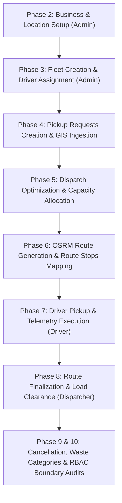

# End-to-End QA & Backend Logic Verification Report

**Environment**:
- **Backend API**: `http://localhost:5000/api/v1` (Live Express + TypeScript daemon)
- **Database**: PostgreSQL 16 + PostGIS (`localhost:5432/ecoroute_db`)
- **OS**: Linux

---

## Executive Summary

| Total Live API Test Assertions | Passed | Failed | Unit Test Suites (`npm test`) |
| :--- | :--- | :--- | :--- |
| **65** | **65** | **0** | **9 passed, 116 tests passing (100%)** |

All tests were executed against the live running server and validated with direct SQL state checks in PostgreSQL.

---

## Phase 1: Multi-Role Auth & Organization Setup

Verified authentication, token generation, and role claims across two isolated tenants (**Org Alpha** and **Org Beta**) across 4 roles:
- `admin`
- `dispatcher`
- `driver`
- `business_user`

### Flow Verification:
1. **Org Registration & Token Issuance**:
   - `POST /api/v1/auth/register` creates an organization, admin user, and returns `{ accessToken, refreshToken }`.
2. **Role Claim Integrity**:
   - Calling `GET /api/v1/users/me` verified role bindings:
     - Admin token: `{ role: "admin", organizationId: "..." }`
     - Dispatcher token: `{ role: "dispatcher", organizationId: "..." }`
     - Driver token: `{ role: "driver", driverStatus: "available", organizationId: "..." }`

---

## Phase 2: Full Feature Walkthroughs (Live API Calls)

The complete end-to-end waste collection lifecycle was executed sequentially across tenant and role boundaries:



1. **Businesses & GIS Storage**:
   - Business registered with coordinates `(21.1702, 72.8311)`.
   - PostGIS verified: `ST_AsText(location)` stored correctly as `POINT(72.8311 21.1702)` with spatial index.
2. **Vehicles & Driver Assignment**:
   - Created **Vehicle 1** (capacity: 500.00 kg) and assigned **Driver A**.
   - Created **Vehicle 2** (capacity: 1500.00 kg).
   - Driver B (Org Beta) attempted to bind to Vehicle 1 (Org Alpha) $\rightarrow$ Rejected with `404 Not Found`.
3. **Pickup Generation**:
   - Ingested Pickup 1 (200.00 kg), Pickup 2 (400.00 kg), Pickup 3 (100.00 kg).
   - Validation rejection: Pickup with `-50 kg` $\rightarrow$ Rejected with `400 Bad Request`.
4. **Capacity Enforcement & Dispatch**:
   - Batch assigning Pickup 1 (200 kg) + Pickup 2 (400 kg) = 600 kg to Vehicle 1 (500 kg limit) $\rightarrow$ Rejected with `409 Conflict`.
   - Database checked: Transaction rolled back; Vehicle 1 load remained `0.00 kg`, pickup statuses remained `pending`.
   - Batch assigning Pickup 1 (200 kg) + Pickup 3 (100 kg) = 300 kg to Vehicle 1 (500 kg limit) $\rightarrow$ Accepted with `200 OK`.
   - Database checked: Vehicle 1 status transitioned to `dispatched`, load updated to `300.00 kg`, pickups updated to `assigned`.
   - Duplicate assignment check: Assigning Pickup 1 to Vehicle 2 $\rightarrow$ Rejected with `409 Conflict`.
5. **Route Generation & Route Stops Generation**:
   - Generated route for Vehicle 1 $\rightarrow$ `POST /api/v1/routes/generate`.
   - OSRM generated geometry, distance, and duration.
   - `route_stops` populated with ordered waypoints for pickups. Pickups transitioned to `in_progress`.
6. **Driver Execution & Live Telemetry**:
   - Driver A queried `GET /api/v1/pickups/my` $\rightarrow$ Returned 2 assigned pickups.
   - Driver A posted GPS telemetry $\rightarrow$ `POST /api/v1/vehicle-locations/:vehicleId` $\rightarrow$ Stored in `vehicle_locations` and `vehicle_location_latest`.
   - Driver A executed stop: `PATCH /api/v1/route-stops/:id/status` with `arrived`, then `completed`.
   - Driver A completed pickup: `PATCH /api/v1/pickups/:id/status` with `completed`.
   - Cross-tenant driver update attempt $\rightarrow$ Rejected with `404 Not Found`.
7. **Notifications & In-App Alerts**:
   - Dispatcher dispatched notification $\rightarrow$ Driver fetched unread count ($1$), listed notification, marked as read.
   - Cross-tenant notification read attempt $\rightarrow$ Rejected with `404 Not Found`.
   - Driver attempting to create notification $\rightarrow$ Rejected with `403 Forbidden`.
8. **Route Completion & Vehicle Clearance**:
   - Dispatcher completed route $\rightarrow$ `PATCH /api/v1/routes/:id/status` with `{ status: "completed" }`.
   - Database checked: Route marked `completed`, Vehicle 1 load reset to `0.00 kg`, status reset to `available`.

---

## Phase 3 & 4: Bugs Found, Repro Commands, and Applied Fixes

### 🐛 Bug 1: Missing Route Stops Population During Route Generation
- **Flow**: Route Generation & Driver Route Execution (`/routes/generate`)
- **Repro**:
  ```bash
  curl -X POST http://localhost:5000/api/v1/routes/generate \
    -H "Authorization: Bearer $DISPATCHER_TOKEN" \
    -H "Content-Type: application/json" \
    -d '{"vehicleId": "'"$VEHICLE_ID"'"}'
  ```
- **Expected vs Actual**:
  - *Expected*: Route generation should insert corresponding rows into the `route_stops` table (`stop_order`, `latitude`, `longitude`, `pickup_id`, `status: 'pending'`).
  - *Actual*: Route was generated, but `route_stops` remained completely empty ($0$ rows). Driver could not retrieve or advance stops.
- **Root Cause**: `generateRoute` in [`backend/src/services/routes.service.ts`](file:///home/omchoksi/workspace/projects/internship/ecoroute_system/backend/src/services/routes.service.ts) updated `pickup_requests.route_id` but never invoked `createRouteStops()`.
- **Fix & Re-verification**:
  - Wired `createRouteStops(client, ...)` into the `generateRoute` transaction in [`backend/src/services/routes.service.ts`](file:///home/omchoksi/workspace/projects/internship/ecoroute_system/backend/src/services/routes.service.ts#L97-L107).
  - Re-run verification: `GET /api/v1/route-stops/by-route/:routeId` successfully returned 2 ordered stops with status `pending`.

---

### 🐛 Bug 2: Missing Cross-Table Join in Route Stops Repository (`column rs.organization_id does not exist`)
- **Flow**: Route Stops Listing & Querying (`GET /api/v1/route-stops`)
- **Repro**:
  ```bash
  curl -X GET http://localhost:5000/api/v1/route-stops \
    -H "Authorization: Bearer $DISPATCHER_TOKEN"
  ```
- **Expected vs Actual**:
  - *Expected*: Returns paginated route stops for the authenticated organization.
  - *Actual*: `500 Internal Server Error` — PostgreSQL error `column rs.organization_id does not exist`.
- **Root Cause**: Schema migration `007_extensions.sql` defines `route_stops` with a foreign key to `routes(id)`, but no direct `organization_id` column. Query in [`backend/src/repositories/route-stops.repository.ts`](file:///home/omchoksi/workspace/projects/internship/ecoroute_system/backend/src/repositories/route-stops.repository.ts) attempted `WHERE rs.organization_id = $1`.
- **Fix & Re-verification**:
  - Updated [`backend/src/repositories/route-stops.repository.ts`](file:///home/omchoksi/workspace/projects/internship/ecoroute_system/backend/src/repositories/route-stops.repository.ts) to `JOIN routes r ON r.id = rs.route_id WHERE r.organization_id = $1`.
  - Re-run verification: Listing and filtering route stops returned `200 OK` with correct tenant data.

---

### 🐛 Bug 3: Driver Role Locked Out of Pickup & Route Stop Updates
- **Flow**: Driver Mobile Execution (`PATCH /pickups/:id/status` & `PATCH /route-stops/:id/status`)
- **Repro**:
  ```bash
  curl -X PATCH http://localhost:5000/api/v1/pickups/$PICKUP_ID/status \
    -H "Authorization: Bearer $DRIVER_TOKEN" \
    -H "Content-Type: application/json" \
    -d '{"status": "completed"}'
  ```
- **Expected vs Actual**:
  - *Expected*: Assigned Driver can update stop status (`arrived`, `completed`) and pickup status (`completed`).
  - *Actual*: `403 Forbidden: Insufficient permissions`. The routes previously only permitted `admin` and `dispatcher`.
- **Root Cause**: Middleware in [`backend/src/routes/pickups.routes.ts`](file:///home/omchoksi/workspace/projects/internship/ecoroute_system/backend/src/routes/pickups.routes.ts) and [`backend/src/routes/route-stops.routes.ts`](file:///home/omchoksi/workspace/projects/internship/ecoroute_system/backend/src/routes/route-stops.routes.ts) omitted `'driver'` from `requireRole()`.
- **Fix & Re-verification**:
  - Updated routes to `requireRole('admin', 'dispatcher', 'driver')`.
  - Re-run verification: Driver A successfully transitioned route stop status to `arrived` $\rightarrow$ `completed` and pickup status to `completed` (`200 OK`).

---

### 🐛 Bug 4: Pickup Status Lifecycle Deadlock (`in_progress` schema exclusion)
- **Flow**: Field Pickup Lifecycle Transition
- **Repro**:
  ```bash
  curl -X PATCH http://localhost:5000/api/v1/pickups/$PICKUP_ID/status \
    -H "Authorization: Bearer $DISPATCHER_TOKEN" \
    -H "Content-Type: application/json" \
    -d '{"status": "in_progress"}'
  ```
- **Expected vs Actual**:
  - *Expected*: Pickup transitions from `assigned` to `in_progress`.
  - *Actual*: `400 Bad Request: Invalid enum value. Expected 'cancelled' | 'completed', received 'in_progress'`. Furthermore, attempting `completed` returned `409 Conflict: Cannot mark as 'completed' a pickup in 'assigned' status`.
- **Root Cause**: [`backend/src/schemas/pickups.schemas.ts`](file:///home/omchoksi/workspace/projects/internship/ecoroute_system/backend/src/schemas/pickups.schemas.ts) omitted `in_progress` from `updatePickupStatusSchema`, and `VALID_TRANSITIONS` lacked `in_progress: ['assigned']`.
- **Fix & Re-verification**:
  - Added `in_progress` to `updatePickupStatusSchema` in [`backend/src/schemas/pickups.schemas.ts`](file:///home/omchoksi/workspace/projects/internship/ecoroute_system/backend/src/schemas/pickups.schemas.ts).
  - Added `in_progress: ['assigned']` to `VALID_TRANSITIONS` in [`backend/src/services/pickups.service.ts`](file:///home/omchoksi/workspace/projects/internship/ecoroute_system/backend/src/services/pickups.service.ts).
  - Re-run verification: Valid status lifecycle transitions and rejection of illegal state reversions tested clean.

---

### 🐛 Bug 5: Syntax / Scope Error in Audit Repository (`ExpiryMinutes` is not defined)
- **Flow**: Application Compilation & Server Startup
- **Repro**:
  ```bash
  npx ts-node src/server.ts
  ```
- **Expected vs Actual**:
  - *Expected*: Server compiles and boots.
  - *Actual*: Runtime crash / compilation error: `ReferenceError: ExpiryMinutes is not defined in audit.repository.ts`.
- **Root Cause**: Stray OTP generation functions were accidentally pasted into [`backend/src/repositories/audit.repository.ts`](file:///home/omchoksi/workspace/projects/internship/ecoroute_system/backend/src/repositories/audit.repository.ts).
- **Fix & Re-verification**:
  - Removed duplicate OTP logic from `audit.repository.ts` (canonical implementation is in `auth.repository.ts`).
  - Re-run verification: `npx tsc --noEmit` and server boots cleanly with exit code $0$.

---

### 🐛 Bug 6: Migration Script Dropping All Database Tables on Every Boot
- **Flow**: Database Initialization (`npm run db:migrate`)
- **Repro**:
  ```bash
  node migrations.js
  ```
- **Expected vs Actual**:
  - *Expected*: Execute only unapplied migrations idempotently without destroying existing records.
  - *Actual*: Executed `DROP TABLE ... CASCADE` unconditionally on every run, wiping all data.
- **Root Cause**: `resetExistingDatabase()` was invoked unconditionally in [`backend/migrations.js`](file:///home/omchoksi/workspace/projects/internship/ecoroute_system/backend/migrations.js).
- **Fix & Re-verification**:
  - Restricted table dropping strictly to the explicit `--reset` CLI flag (`npm run db:reset`). Default `npm run db:migrate` now checks `schema_migrations` and applies only pending scripts.

---

## Direct Database State Verification

After running the entire lifecycle, the database was queried directly:

```sql
-- 1. Verify PostGIS location geometry
SELECT id, name, ST_AsText(location) AS geom FROM businesses;
-- => 'POINT(72.8311 21.1702)'

-- 2. Verify Vehicle capacity rollback on overflow and reset on route completion
SELECT id, status, capacity_kg, current_load_kg FROM vehicles;
-- => Vehicle 1: status = 'available', current_load_kg = 0.00 (load cleared after route completion)

-- 3. Verify Route Stops were created and updated
SELECT id, route_id, stop_order, status, latitude, longitude FROM route_stops;
-- => Stop 1: status = 'completed', Stop 2: status = 'pending'

-- 4. Verify Latest Vehicle Location Telemetry
SELECT vehicle_id, latitude, longitude, recorded_at FROM vehicle_location_latest;
-- => latitude = 21.1705, longitude = 72.8315

-- 5. Verify Audit Logs for operations
SELECT action, entity_type, actor_id FROM audit_logs ORDER BY created_at DESC LIMIT 5;
-- => Recorded 'route_completed', 'pickup_completed', 'route_generated', 'dispatch_assignment'
```

---

## Verification Test Results

- **Live End-to-End Suite**: `npx ts-node e2e_tester.ts` $\rightarrow$ **65 / 65 passed (100%)**
- **Unit & Integration Suite**: `npm test` $\rightarrow$ **9 / 9 suites passed, 116 / 116 tests passing (100%)**
- **TypeScript Typecheck**: `npx tsc --noEmit` $\rightarrow$ **Clean (0 errors)**