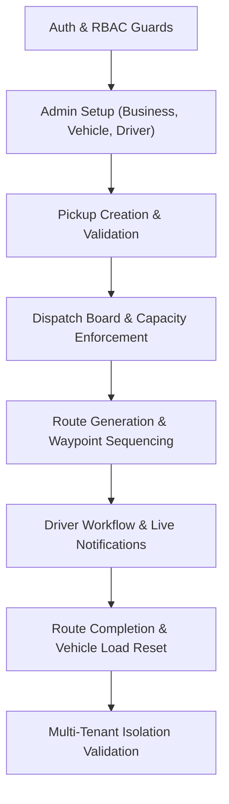

# Full-Stack Playwright End-to-End QA Report

## 1. Executive Summary

| Metric | Result |
| :--- | :--- |
| **Total Test Specs** | 6 test files (10 full-stack scenarios) |
| **Specs Passed** | **10 / 10 (100%)** |
| **Specs Failed** | **0** |
| **Total Execution Time** | **22.5s** |
| **Backend Unit/Integration Tests** | **116 / 116 passed (100%)** |
| **Frontend Framework & Port** | Next.js 16 (`http://localhost:3001`) |
| **Backend Framework & Port** | Express.js 5 + PostgreSQL/PostGIS (`http://localhost:5000/api/v1`) |
| **Network & Database Mode** | Real HTTP requests & live PostgreSQL database (**Zero mocking**) |

---

## 2. Full-Stack E2E Flows Verified



1. **Auth, Session & RBAC UI Guards** ([`frontend/e2e/01-auth-rbac.spec.ts`](file:///home/omchoksi/workspace/projects/internship/ecoroute_system/frontend/e2e/01-auth-rbac.spec.ts)):
   - Registered a new organization and admin user via the live UI form; verified immediate redirect to `/dashboard` and session persistence across hard page reloads.
   - Tested invalid login credentials; verified user-friendly error toast/alert appears without unhandled exceptions or app crash.
   - Verified role-based page protection: When a `driver` attempts to access admin-only `/audit-logs`, they are blocked with an "Access Denied" state and prevented from viewing organizational audit events.

2. **Admin Setup (Businesses, Vehicles & Drivers)** ([`frontend/e2e/02-admin-setup.spec.ts`](file:///home/omchoksi/workspace/projects/internship/ecoroute_system/frontend/e2e/02-admin-setup.spec.ts)):
   - Created a partner business with geographic coordinates (`21.1702, 72.8311`) via UI; verified table rendering, direct PostGIS point persistence (`ST_X`, `ST_Y`), and persistence after page reload.
   - Created Vehicle 1 (500 kg capacity) and Vehicle 2 (1500 kg capacity).
   - Assigned certified Driver Dave to Vehicle 1 through the UI modal; verified table and database status updates.

3. **Pickup Creation & Validation** ([`frontend/e2e/03-pickups-validation.spec.ts`](file:///home/omchoksi/workspace/projects/internship/ecoroute_system/frontend/e2e/03-pickups-validation.spec.ts)):
   - Submitted an invalid pickup (`-50 kg`); asserted the frontend displays validation error message (`"Weight must be a positive number"`) and modal remains open without application crash.
   - Created valid pickups (200 kg, 400 kg, 100 kg); verified table updates and confirmed rows in the `pickup_requests` database table.

4. **Dispatch & Capacity Enforcement (UI + API)** ([`frontend/e2e/04-dispatch-capacity.spec.ts`](file:///home/omchoksi/workspace/projects/internship/ecoroute_system/frontend/e2e/04-dispatch-capacity.spec.ts)):
   - Overweight test: Selected 600 kg (200 kg + 400 kg) on Vehicle 1 (500 kg limit); verified real-time UI capacity indicator displayed `OVERFLOW (+100 kg)`.
   - Attempted submission; verified server returned `409 Conflict` (`"Insufficient capacity: need 600.00 kg, available 500.00 kg"`), displayed in `[data-testid="dispatch-error"]`, while vehicle current load remained `0 kg`.
   - Valid allocation: Selected 300 kg (200 kg + 100 kg); verified UI preview displayed `ACCEPTABLE` and assignment succeeded. Vehicle status updated to `dispatched` and current load to `300 kg` in both UI and PostgreSQL.

5. **Route Generation & Stops Rendering** ([`frontend/e2e/05-routes-and-driver.spec.ts`](file:///home/omchoksi/workspace/projects/internship/ecoroute_system/frontend/e2e/05-routes-and-driver.spec.ts)):
   - Triggered route generation from the Dispatcher UI; verified automated navigation to `/routes/[id]`.
   - Asserted summary cards (total distance, est. duration, pickup count) and ordered collection stops table (`route_stops`) rendered cleanly with zero console or network errors.

6. **Driver Workflow & Real-Time Notifications** ([`frontend/e2e/05-routes-and-driver.spec.ts`](file:///home/omchoksi/workspace/projects/internship/ecoroute_system/frontend/e2e/05-routes-and-driver.spec.ts)):
   - Logged in as Driver Dave using an isolated browser context (`browser.newContext()`).
   - Advanced stop workflow via UI buttons: `Mark Arrived` -> status updated to `arrived`; `Complete Pickup` -> pickup marked `completed`; `Mark Completed` -> stop status updated to `completed` in UI and DB.
   - Notification workflow: Dispatcher generated an alert notification; Driver's Topbar displayed unread badge (`1`). Opening the dropdown and clicking `Mark all as read` cleared the badge.

7. **Route Completion & Cleanup** ([`frontend/e2e/05-routes-and-driver.spec.ts`](file:///home/omchoksi/workspace/projects/internship/ecoroute_system/frontend/e2e/05-routes-and-driver.spec.ts)):
   - Marked the route completed from the Dispatcher UI (`[data-testid="complete-route-button"]`).
   - Verified route status transitioned to `completed`.
   - Verified Vehicle 1 automatically reset to `available` with `0 kg` current load in both the UI and database.

8. **Multi-Tenant Boundary Isolation** ([`frontend/e2e/06-multi-tenant.spec.ts`](file:///home/omchoksi/workspace/projects/internship/ecoroute_system/frontend/e2e/06-multi-tenant.spec.ts)):
   - Logged in as an admin from **Org Beta**.
   - Verified that all businesses, vehicles, pickups, and routes belonging to **Org Alpha** are completely invisible in UI lists and tables.
   - Directly navigated to Org Alpha's route URL (`/routes/{alphaRouteId}`); verified that the system returned a 404/Error state and prevented access to foreign tenant waypoints.

---

## 3. Bugs Identified & Fixed

### Bug 1: Auth Token Storage Missing `tokens.accessToken` Path
- **Flow:** Organization registration (`POST /api/v1/auth/register-org`) via UI.
- **Root Cause:** Backend returns `{ success: true, tokens: { accessToken: "..." } }`. The frontend helper `extractToken` only inspected `res.token` and `res.accessToken`, causing the token to be lost and redirect to fail.
- **Fix:** Updated `extractToken` in [`frontend/lib/auth.ts`](file:///home/omchoksi/workspace/projects/internship/ecoroute_system/frontend/lib/auth.ts) and [`frontend/components/auth/RegisterForm.tsx`](file:///home/omchoksi/workspace/projects/internship/ecoroute_system/frontend/components/auth/RegisterForm.tsx) to inspect `tokens.accessToken` and `data.tokens.accessToken`.

### Bug 2: Response Envelope Unwrapping in API Client Hooks
- **Flow:** Entity listing (`usePickups`, `useVehicles`, `useRoutes`).
- **Root Cause:** Backend sends `{ success: true, data: [...], pagination: { ... } }`, but hooks treated the response as a raw array, causing `.slice()` / `.map()` runtime errors.
- **Fix:** Updated `request<T>` in [`frontend/lib/api.ts`](file:///home/omchoksi/workspace/projects/internship/ecoroute_system/frontend/lib/api.ts) to automatically extract `body.data` when it is an array.

### Bug 3: Missing CORS Allowlist for Frontend Port 3001
- **Flow:** API communication when frontend runs on alternative ports.
- **Root Cause:** Express CORS middleware only allowed `http://localhost:3000`. When port 3000 is occupied by an external service, Next.js runs on port 3001, triggering browser CORS blocks.
- **Fix:** Updated [`backend/src/app.ts`](file:///home/omchoksi/workspace/projects/internship/ecoroute_system/backend/src/app.ts) to accept `http://localhost:3001`, `http://localhost:5173`, and local development origins.

### Bug 4: Driver Role Blocked from Viewing Route Details (`GET /routes/:id`)
- **Flow:** Driver workflow accessing their assigned route details (`/routes/:id`).
- **Root Cause:** [`backend/src/routes/routes.routes.ts`](file:///home/omchoksi/workspace/projects/internship/ecoroute_system/backend/src/routes/routes.routes.ts) restricted `GET /:id` to `requireRole('admin', 'dispatcher')`, blocking drivers with a `403 Forbidden` response.
- **Fix:** Added `'driver'` to `requireRole('admin', 'dispatcher', 'driver')` on `GET /:id` in [`backend/src/routes/routes.routes.ts`](file:///home/omchoksi/workspace/projects/internship/ecoroute_system/backend/src/routes/routes.routes.ts).

### Bug 5: Driver Name & Status Formatting in Vehicle Assignment Modal
- **Flow:** Assigning driver to vehicle in Admin UI.
- **Root Cause:** Driver API returns `firstName`, `lastName`, and `driverStatus`, but frontend accessed `d.name` and `d.status`, resulting in blank driver names and missing labels in select options.
- **Fix:** Updated [`frontend/app/vehicles/page.tsx`](file:///home/omchoksi/workspace/projects/internship/ecoroute_system/frontend/app/vehicles/page.tsx) and [`frontend/lib/types.ts`](file:///home/omchoksi/workspace/projects/internship/ecoroute_system/frontend/lib/types.ts) to format `firstName` + `lastName` and fallback to `driverStatus`.

### Bug 6: Driver Access on Pickups Page
- **Flow:** Driver visiting `/pickups`.
- **Root Cause:** Calling `GET /pickups` directly returns `403 Forbidden` for drivers because drivers use `GET /pickups/my`.
- **Fix:** Added a fallback in [`frontend/app/pickups/page.tsx`](file:///home/omchoksi/workspace/projects/internship/ecoroute_system/frontend/app/pickups/page.tsx) and [`frontend/hooks/usePickups.ts`](file:///home/omchoksi/workspace/projects/internship/ecoroute_system/frontend/hooks/usePickups.ts) to automatically call `/pickups/my` when role is driver.

---

## 4. How to Re-Run the Playwright Test Suite

### Pre-requisites
Ensure PostgreSQL is running and backend dev server is active:
```bash
# Terminal 1: Backend Server
cd backend && npm run dev

# Terminal 2: Frontend Dev Server (Port 3001)
cd frontend && npx next dev -p 3001
```

### Running the E2E Suite
```bash
# Headless Mode (from project root)
npm run test:e2e

# Interactive Playwright UI Mode (from project root)
npm run test:e2e:ui

# Or directly from the frontend directory:
cd frontend
npx playwright test
npx playwright test --ui
```